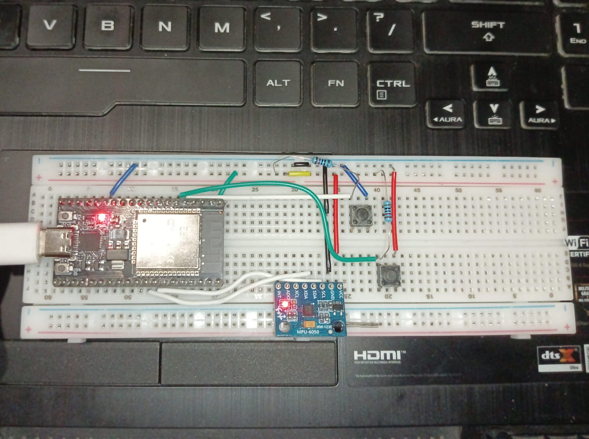
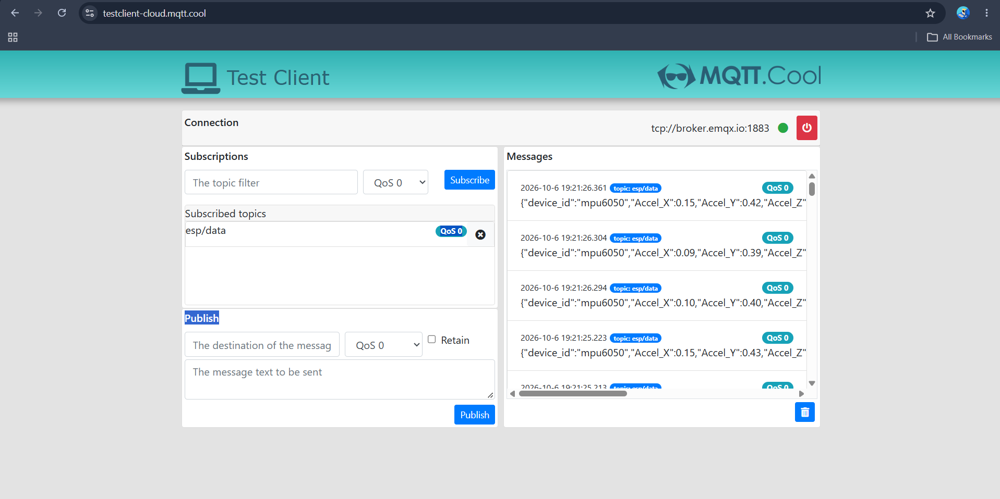

# ESP32 Gyro Mouse

A wireless air mouse built using ESP32 and MPU6050. It uses gyroscope movement to control the computer cursor and two push buttons for left and right clicks.

## Hardware Setup

## How It Works

- **ESP32:** Reads gyroscope data from the MPU6050 over I2C and monitors the push buttons.
- **MQTT:** ESP32 publishes sensor readings and button states as JSON messages to the `esp/data` topic.
- **MQTT Broker:** Uses the public EMQX broker at `broker.emqx.io:1883` with QoS 0.
- **Python Client:** Subscribes to `esp/data` using Paho MQTT, processes the incoming data, and uses PyAutoGUI to control the mouse cursor and clicks.

## MQTT Communication

Example MQTT configuration:

- Broker: `broker.emqx.io`
- Port: `1883`
- Topic: `esp/data`
- Protocol: MQTT
- QoS: 0

## Technologies

- ESP32 and ESP-IDF
- MPU6050 (I2C)
- MQTT / EMQX
- Python
- Paho MQTT
- PyAutoGUI